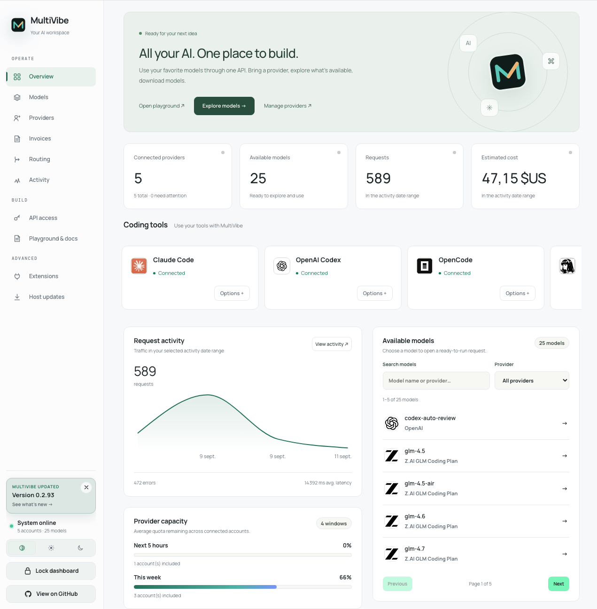

<p align="center">
  <a href="https://multivibe.cloud">
    <picture>
      <source media="(prefers-color-scheme: dark)" srcset="./assets/brand/vector/multivibe-logo-domain-dark-outlined.svg" />
      <source media="(prefers-color-scheme: light)" srcset="./assets/brand/vector/multivibe-logo-domain-light-outlined.svg" />
      
    </picture>
  </a>
</p>

<p align="center">
  <strong>Your providers. Your hardware. One AI gateway.</strong>
</p>

<p align="center">
  <a href="https://github.com/thibautrey/multivibe/releases/latest"></a>
  <a href="https://github.com/thibautrey/multivibe/releases"></a>
  <a href="https://github.com/thibautrey/multivibe"></a>
  <a href="./LICENSE"></a>
</p>

<p align="center">
  A free, self-hosted gateway for coding agents and AI apps.<br />
  Connect provider accounts, route around quotas, and use your preferred AI providers.
</p>

<p align="center">
  <a href="#download-multivibe-host"><strong>Download MultiVibe Host</strong></a> ·
  <a href="https://github.com/thibautrey/multivibe/wiki/Quick-start#-quick-start"><strong>Run the gateway</strong></a> ·
  <a href="https://github.com/thibautrey/multivibe/wiki/API-reference#-api-surface">Explore the API</a> ·
  <a href="https://github.com/thibautrey/multivibe/wiki/Local-development">Contribute</a>
</p>


<p align="center">
  <a href="https://github.com/thibautrey/multivibe/wiki/Dashboard"></a>
  <br />
  <sub>Current dashboard · Fictional data from the local demo instance</sub>
</p>

## ✨ At a glance

| One endpoint | Resilient routing | Ya third-party service |
| --- | --- | --- |
| Connect OpenAI-compatible clients, Codex, and Anthropic Messages clients. | Discover models, balance quota headroom, and fail over between accounts. | Self-host the gateway or run the complete Host on supported hardware. |
| Responses, Chat Completions, SSE, Realtime, and WebSocket support. | Add model aliases, local/cloud policies, budgets, and deferred jobs. | Manage API keys, inspect traces, and track tokens, costs, and latency. |

<details>
<summary><strong>Full capabilities and gateway architecture</strong></summary>

| Area | What MultiVibe provides |
| --- | --- |
| Client APIs | Responses, Chat Completions, Anthropic Messages, models, Realtime WebRTC, cascaded Realtime voice over WebSocket, SSE, and Responses over WebSocket |
| Providers | OpenAI/ChatGPT, GitHub Copilot, Poe, MiniMax, OpenRouter, Abacus.AI, Manus, Kimi, Hugging Face, Mammouth AI, Qwen Coding Plan, Z.AI GLM Coding Plan, Perplexity, Grok Build, OpenCode Zen/Go, Mistral, and other reviewed or custom APIs. See [provider setup and quota coverage](docs/providers/README.md). |
| Account routing | Automatic model discovery, quota headroom selection, account/model blocks, retries, and optional Codex session affinity |
| Smart aliases | Conditional schema-v2 policies, local/cloud candidates, capacity constraints, scoring, budgets, simulation, and queue/reject fallbacks |
| Deferred work | Durable edge jobs, priority and application fairness, idempotency, polling/SSE results, cancellation, and signed webhooks |
| Operations | Admin dashboard, lifecycle plugins, dynamic application API keys, traces, cost/token/latency statistics, project attribution, exports, and Sentry integration |

MultiVibe exposes the same inference routes under `/v1` and at the root for
clients that expect either style. In the shipped Compose profile, the public
`:1455` socket is served directly by the native Rust edge; Node.js remains on
loopback `127.0.0.1:1456` for the dashboard UI, OAuth, static assets, and the
dashboard resource routes that have not yet migrated. Rust owns dashboard
session authentication, the outer admin access guard, health, the read-only API
key and application-policy inventories, and all public inference routes.
Compatibility endpoints for Ollama- and LiteLLM-style discovery are also
available.

Reach the dashboard through `:1455`, never through `:1456`. The control plane
port stays on container loopback by design and is not a second entry point, so
publishing or browsing `1456` returns a refused connection. The edge reverse
proxies every dashboard route to it after session authentication.

`ADMIN_TOKEN` protects the dashboard and must be set for any host reachable
beyond your own machine. The Compose default (`change-me`) is a placeholder:
while it is in effect the instance logs a startup warning and the admin boundary
accepts a publicly known value. Set `ADMIN_TOKEN` in `.env` next to
`docker-compose.yml`; local overrides belong in an untracked
`docker-compose.override.yml`.

#### Users, quotas and plans

Dashboard accounts live in `accounts.json` and sign in with email + password.
An admin creates users, sets quotas and plans, and can send a one-time invite
link from the **Users** tab. Members only see their own providers, API keys,
activity and quota.

Billing is pay-as-you-go by default: a per-user USD credit cap plus optional
token and request caps over a day, month or total period. The admin can also
enable a subscription plan per user with rolling windows such as 5 hours and
weekly. Each window caps credit, tokens or requests, and the edge enforces
every window alongside the usage quota. A user's counters roll over at the
window boundary, anchored at first use.

A user can also hold a **prepaid balance** (`walletUsd`), credited by an admin
from the **Users** tab or, later, by a Stripe top-up. It never resets with the
quota period: a request spends the period allowance first, then the prepaid
balance, and the account is blocked once both are exhausted. Each movement is
recorded in a bounded audit trail (allowance grant, top-up, adjustment, refund,
debit) visible in the same panel. Members see their own balance, remaining
credit and subscription windows in the **Credit** tab; with neither an
allowance nor a balance they simply have unlimited credit, as on a plain
self-hosted instance. A request that is already running is never cut off, so
the prepaid balance may end slightly negative (or deeply negative after one
expensive request); it stays visible, and every new request is refused until
the balance is topped up.

#### Marketplace billing (Stripe Connect)

An instance can also let members buy that prepaid balance by card. The
**Payments** tab enrolls the instance with the MultiVibe marketplace, opens a
Stripe Connect v2 onboarding link in one click, and edits the credit packs the
**Credit** tab sells. The admin stays the merchant of record: the charge is a
direct charge on the admin's own Stripe account, MultiVibe keeps a per-instance
commission (5% by default), and refunds are issued from the same panel.

The marketplace broker is a separate service in `services/marketplace`; see its
README for deployment. The default broker is
`https://marketplace.multivibe.cloud`, and enrollment stays inert until an
admin asks for it, so a stock instance never talks to the marketplace on its
own. Override or disable it with:

```sh
# Use a self-hosted broker instead of the default marketplace:
MULTIVIBE_MARKETPLACE_URL=https://payments.example.com
# Disable marketplace enrollment entirely:
MULTIVIBE_MARKETPLACE_URL=
# Optional: default is data/payments-credentials.json (mode 0600)
MULTIVIBE_MARKETPLACE_SECRET_PATH=/data/payments-credentials.json
# Optional: outbox polling interval, 60 s by default
MULTIVIBE_MARKETPLACE_POLL_INTERVAL_MS=60000
```

To run the broker yourself, `cd services/marketplace`, create `.env` from
`.env.example`, and `docker compose up -d --build`; the container exposes
`:1460`, stores its state in `services/marketplace/data/marketplace.json`, and
serves `/health`, the operator enrollment page `/enroll` and the two Stripe
webhook endpoints.

Enrollment uses a short code, never an OAuth redirect, so an instance behind
NAT or plain HTTP still works: the admin approves the code on the marketplace,
and the instance receives its signing secret exactly once. That secret lives in
the 0600 credentials file, not in `accounts.json`.

Payments are pull-based and idempotent. The browser return page never credits
anything; the instance verifies the Checkout session with the broker and credits
the wallet through the same `paymentId` guard used by the signed event outbox.
A background poller pulls new events, and a daily reconciliation re-reads recent
sessions so a missed event cannot leave a paid member uncredited. Refunds and
disputes debit the wallet proportionally, and a chargeback can push it negative
so the debt stays visible and blocks new requests.

The **Models** tab lets an admin set the billed price per model in USD per
million input, cached-input and output tokens. Custom rates override the
upstream estimate in usage accounting and dashboards; clearing one restores the
catalog price. The **Users** tab also limits which exposed models each member may
call, matching the exposed id and alias names. The edge rejects other models and
hides them from that member's catalog.

An optional off-peak calendar discounts those billed rates during chosen hours.
The schedule holds one or more local time ranges per weekday and is evaluated in
an explicit IANA timezone (UTC by default). A range whose end precedes its start
continues into the next day, so `22:00 → 06:00` declared on Friday also covers
Saturday morning. Models with off-peak rates use them while the calendar is
enabled and a range matches the request time; other models keep the standard
rate. Prices are resolved when a trace is priced, so activities, dashboards and
quota debits stay consistent.

Passkeys are optional. After signing in, **Add passkey** in the sidebar
registers a credential for the current account; the login page can then sign
in without a password. WebAuthn binds a credential to the dashboard hostname,
so behind a proxy set `MULTIVIBE_PUBLIC_ORIGIN` (and, when the RP ID differs
from that hostname, `MULTIVIBE_WEBAUTHN_RP_ID`) to the public origin.

</details>

### Find your way

| Get started | Use the gateway | Operate and extend |
| --- | --- | --- |
| [Download the Host](#download-multivibe-host) | [Providers and onboarding](https://github.com/thibautrey/multivibe/wiki/Providers-and-onboarding#-providers-and-onboarding) | [Tracing and projects](https://github.com/thibautrey/multivibe/wiki/Tracing-and-projects#-tracing-and-project-attribution) |
| [Gateway quick start](https://github.com/thibautrey/multivibe/wiki/Quick-start#-quick-start) | [API reference and examples](https://github.com/thibautrey/multivibe/wiki/API-reference#-api-surface) | [Storage and local models](https://github.com/thibautrey/multivibe/wiki/Persistence-and-local-models#-persistence) |
| [Dashboard tour](https://github.com/thibautrey/multivibe/wiki/Dashboard) | [Routing and aliases](https://github.com/thibautrey/multivibe/wiki/Routing-and-aliases#-routing-strategy) | [Configuration](https://github.com/thibautrey/multivibe/wiki/Configuration) |
| [Installation guide](./packaging/PROVIDER-HOST-README.md) | [Realtime voice gateway](./docs/realtime-voice-gateway.md) · [Audio and live voice](./docs/audio-plugin.md) · [Plugin API](./docs/plugins-api.md) | [Development](https://github.com/thibautrey/multivibe/wiki/Local-development) · [More docs](https://github.com/thibautrey/multivibe/wiki/Home) |

---

<a id="download-multivibe-host"></a>

## ⬇️ Download MultiVibe Host

MultiVibe Host is the fastest way to run the complete, security-bounded local
Host: gateway, dashboard, private device identity, provider agent, and managed
model runtime. Official builds are published together in one verified release.

| Platform | Official package | Requirements | Download |
| --- | --- | --- | --- |
| **macOS** | Signed and notarized `.dmg` for Apple Silicon and Intel | Apple Silicon (`arm64`) or Intel (`amd64`) Mac | **[Download the latest macOS release →](https://github.com/thibautrey/multivibe/releases/latest)** |
| **Linux** | Signed native Host archive | Linux `x86_64` | **[Download the latest Linux release →](https://github.com/thibautrey/multivibe/releases/latest)** |
| **Windows** | Verified native `.zip` for amd64 | Windows amd64 | **[Download the latest Windows release →](https://github.com/thibautrey/multivibe/releases/latest)** |
| **Docker / Unraid** | Hardened image on GitHub Container Registry | Linux `x86_64`, Docker or Unraid | **[Open the latest Docker release →](https://github.com/thibautrey/multivibe/releases/latest)** |

<details>
<summary><strong>macOS installation</strong></summary>

### macOS

Open the latest release and choose the disk image for your Mac:

- `darwin_arm64.dmg` for Apple Silicon (M1 or newer)
- `darwin_amd64.dmg` for Intel

Open the DMG, drag **MultiVibe Host** to **Applications**, then launch it. The
app is signed with Developer ID, notarized by Apple, and runs from the menu bar.
Its menu-bar label follows the provider used most recently and shows that
provider's remaining capacity: quota windows when it bills a subscription, or
the remaining prepaid credit in its own currency when it bills pay-as-you-go.
Opening it presents a native account overview with per-account quota windows,
credit balances, reset times, and health without exposing account tokens to the
interface process.

</details>

<details>
<summary><strong>Linux installation</strong></summary>

### Linux

Download the Linux `amd64` release assets and follow `NATIVE-MULTIPART.txt` when
the archive is split into several parts. After reconstructing and extracting
the archive, run:

```sh
./install.sh
```

The installer verifies the release bundle before it
starts the Host. It installs for the current user and does not require root.
On systems with a user systemd manager it also enables the signed automatic
update timer. The timer checks hourly but the updater itself schedules one
network check every 10 to 14 hours with a local random offset.

</details>

<details>
<summary><strong>Windows installation</strong></summary>

### Windows

Download the `windows_amd64.zip` release, extract it to a temporary directory,
then run PowerShell as the current user:

```powershell
powershell.exe -NoProfile -ExecutionPolicy Bypass -File .\install.ps1
```

The installer verifies the complete bundle before changing the machine.
It requires Windows amd64, installs without administrator privileges, and
registers a per-user Start Menu shortcut, login entry, `multivibe://` protocol
handler, and scheduled update task. The native Win32 tray menu starts and
stops the Host and opens the local dashboard. Application files are kept under
`%LOCALAPPDATA%\Programs\MultiVibe Host`; private state and logs remain under
`%LOCALAPPDATA%\MultiVibe`.

PowerShell 5.1 or newer is required. The Windows updater verifies the signed
feed and ZIP contents, stops only MultiVibe processes whose executable paths
belong to the managed installation, and restores the previous version if the
new Host does not pass its health check.

</details>

<details>
<summary><strong>Docker and Unraid installation</strong></summary>

### Docker and Unraid

The current Host release workflow publishes the same verified Linux bundle to
GHCR as both an immutable version and the rolling `latest` tag:

```sh
docker pull ghcr.io/thibautrey/multivibe-host:latest
```

For reproducible deployments, use the versioned tag or immutable digest shown
in the matching [latest GitHub release](https://github.com/thibautrey/multivibe/releases/latest).
Additional Docker Hub, Homebrew, NAS and Windows distribution packages are documented in the [distribution guide](packaging/distribution/README.md). These channels require publication and platform validation before being advertised as available.

For Unraid, see the [installation and Community Applications submission guide](packaging/unraid/README.md). The template is available for manual installation; a public store listing still requires Community Applications acceptance.

Docker Compose and Unraid setup are documented in
[Provider Host container](https://github.com/thibautrey/multivibe/wiki/Persistence-and-local-models#provider-host-container-docker-compose-and-unraid).

</details>

### Updates and release verification

Native macOS, Linux, and Windows installations check an authenticated release feed and,
by default, download and install an eligible stable release overnight (02:00–06:00
in the machine's local time), without confirmation. Each installation persists a
random start between 02:00 and 05:00 to spread download traffic. Missed windows
and busy Hosts defer to a later night, including after wake or restart. Downloads
and installation require 30 minutes without requests, WebSocket turns, or jobs;
installation rechecks activity after draining. Unknown activity fails closed.
Explicit download/install actions bypass the overnight schedule, but installation
still requires the quiet period. The updater drains new work, waits for active requests and model
operations, verifies the archive with an embedded Ed25519 trust root, stages
the replacement, and restores the previous version if the restarted Host does
not pass its health check. The dashboard and macOS menu bar can switch between
automatic installation, automatic download, and notification-only modes.

Containers never receive the Docker socket and never replace themselves. For
generic Docker Compose, install the host-side updater from the verified Linux
archive. Unraid users may use the platform's automatic application update
mechanism with the published `latest` tag.

> [!NOTE]
> If GHCR reports that the package is not found, no tagged Host release with
> Docker publishing has completed yet. Use an official native release or build
> from this repository instead of installing an unverified third-party image.

> [!TIP]
> Native archives include signed checksums, SBOMs, and GitHub build-provenance
> attestations. See the [verification and installation guide](./packaging/PROVIDER-HOST-README.md)
> before deploying a Host on shared or production infrastructure.


## 📚 Documentation

The **[GitHub wiki](https://github.com/thibautrey/multivibe/wiki/Home)** contains the user guides, API reference, configuration, architecture, and historical reports.

- [Quick start](https://github.com/thibautrey/multivibe/wiki/Quick-start)
- [Dashboard](https://github.com/thibautrey/multivibe/wiki/Dashboard)
- [Providers and onboarding](https://github.com/thibautrey/multivibe/wiki/Providers-and-onboarding)
- [API reference](https://github.com/thibautrey/multivibe/wiki/API-reference)
- [Plugin API reference and migration guide](./docs/plugins-api.md) — sandbox, settings, model services, private SQLite storage, completion telemetry, and virtual routing
- [Audio and live voice](./docs/audio-plugin.md) — configure the models behind a local GPT-Live-compatible voice server
- [Routing and aliases](https://github.com/thibautrey/multivibe/wiki/Routing-and-aliases)
- [Configuration](https://github.com/thibautrey/multivibe/wiki/Configuration)
- [Local development](https://github.com/thibautrey/multivibe/wiki/Local-development)


## 🤝 Contributing

Focused pull requests and issues are welcome. For UI changes, include a
before/after description and screenshots. For behavior changes, add or update
tests and report the validation commands you ran.


## 👥 Contributors

<a href="https://github.com/thibautrey/multivibe/graphs/contributors">
  
</a>

Thanks to everyone who has helped improve MultiVibe. This gallery is generated
from GitHub's contributor graph and updates automatically.

[View all contributors and their commits](https://github.com/thibautrey/multivibe/graphs/contributors).


## 📄 License

The source code in this repository, including MultiVibe Core and its auditable
provider-host agent, is licensed under the [Apache License 2.0](./LICENSE). The
license includes an explicit patent grant and permits inspection, modification,
and redistribution under its terms. It does not grant access to the hosted
multivibe.cloud service, service accounts, credentials, customer data, or
Pleiades Solutions trademarks beyond Apache-2.0 Section 6.


## ⭐ Star History

[View the public star history](https://www.star-history.com/?type=date&repos=thibautrey%2Fmultivibe).

### AI release notes in GitHub Actions

Host (`v*`) and Core source (`source-v*`) releases generate notes before publishing.
Configure these repository **Settings → Secrets and variables → Actions** entries:

| Type | Name | Value |
| --- | --- | --- |
| Variable | `RELEASE_NOTES_API_BASE_URL` | OpenAI-compatible API base URL including its API prefix, for example `https://api.openai.com/v1` |
| Variable | `RELEASE_NOTES_MODEL` | A model ID supported by that endpoint |
| Secret | `RELEASE_NOTES_API_KEY` | API key for that endpoint |

The generator calls `POST <base-url>/chat/completions`. It sends committed release
messages, GitHub's PR changelog, diff statistics and a bounded code patch to the
configured provider. The key is available only to the notes step, never build jobs.
No provider response bodies or credentials are logged. Configure an endpoint that
is reachable from the GitHub runner and permitted to process this repository's code.

The baseline is the highest earlier published version in the same tag family whose
commit is an ancestor of the new release. Stable releases exclude prereleases;
prereleases can compare against earlier prereleases. Drafts, future versions and the
current release are excluded. A first release uses its committed history. The full
GitHub changelog and comparison link remain available beneath the AI summary.
Inputs are bounded and marked when truncated; generated summaries may omit detail.

Download links are assembled from the actual release files, including multipart
archives and reconstruction instructions. Unsupported/unbuilt targets are omitted.
Existing container installation instructions remain in Host notes. Missing AI
configuration, timeouts, invalid responses, or any other notes-generation failure
produce a CI warning without failing the release job. The optional step has a
three-minute timeout. On failure, Host releases use the original GitHub-generated
notes plus container instructions; source releases use their original static
release description. Failed or partial notes files are never published.

Run `node --test scripts/generate-release-notes.test.mjs` to validate without an API
key. Both release workflows write `release-notes.md` outside the signed asset folder
and pass it to `gh release create --notes-file`.
